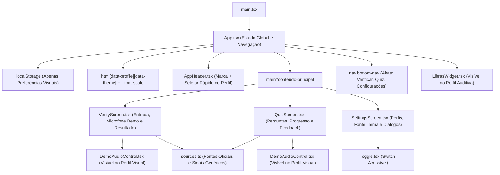

# Documentação Técnica do Front-End — Voto Claro

Este documento detalha tudo o que foi construído no front-end do protótipo **Voto Claro**, como os arquivos e estados estão organizados e **onde atuar para evoluir visualmente, tecnicamente e funcionalmente** a aplicação.

> **Importante:** O front-end atual opera 100% no navegador como um **protótipo educativo demonstrativo**. Nenhum texto digitado pelo usuário é salvo ou enviado pela rede, e recursos como análise de atenção, microfone, leitura em áudio, notificações e Libras são simulações visuais de interface.

---

## 1. Stack e Configuração

| Camada | Escolha Técnica | Arquivo de Referência |
| :--- | :--- | :--- |
| **Biblioteca de UI** | React `^18.3.1` (componentes funcionais e Hooks) | `package.json` |
| **Tipagem** | TypeScript `~5.6.2` com `strict: true` | `tsconfig.json` |
| **Bundler / Dev Server** | Vite `^5.4.11` (`host: true`, porta `5173`) | `vite.config.ts` |
| **Estilização** | CSS moderno baseado em Design Tokens (Custom Properties), sem bibliotecas externas | `src/styles.css` |
| **Ícones e Ilustrações** | SVGs vetoriais locais inline (zero requisições externas) | `src/components/Icon.tsx` |
| **Atalho de Execução (Windows)** | Script `.bat` contornando bloqueio de `ExecutionPolicy` do PowerShell | `iniciar.bat` |

---

## 2. Arquitetura de Componentes e Fluxo de Dados

O estado global foi centralizado de forma enxuta em `src/App.tsx`, mantendo **estados independentes** para evitar acoplamento e facilitar futuras refatorações (como Context API ou Zustand).



---

## 3. Mapa Completo dos Arquivos (`src/`)

| Arquivo | Responsabilidade Principal |
| :--- | :--- |
| `src/main.tsx` | Ponto de entrada React (`StrictMode`) e importação global do CSS. |
| `src/types.ts` | Contratos TypeScript (`TabId`, `AccessibilityProfile`, `ThemeMode`, `AnalysisStatus`, `QuizQuestion`, `TrustedSource`, `UserPreferences`). |
| `src/config/sources.ts` | Dados estáticos desacoplados da UI: URLs oficiais (`TRUSTED_SOURCES`), sinais genéricos (`DEMO_ATTENTION_SIGNALS`) e banco de perguntas (`QUIZ_QUESTIONS`). |
| `src/App.tsx` | Gerencia estados separados, sincroniza atributos no `<html>`, persiste preferências em `localStorage`, controla o timer demonstrativo da análise e renderiza a navegação inferior. |
| `src/components/AppHeader.tsx` | Cabeçalho fixo (`sticky`) com identidade **Voto Claro**, indicador do perfil atual e seletor rápido (`Padrão`, `Visual`, `Auditiva`). |
| `src/components/VerifyScreen.tsx` | Formulário de entrada multilinha, validação de campo vazio com foco automático, botão simulado de microfone (**Pronto** / **Ouvindo**), estado vazio, carregamento e cartão de resultado demonstrativo. |
| `src/components/QuizScreen.tsx` | Barra de progresso, alternativas agrupadas em `<fieldset>`/`<legend>`, destaque de acerto/erro com texto explícito, explicação educativa e botões **Tentar novamente** / **Próxima pergunta**. |
| `src/components/SettingsScreen.tsx` | Seleção detalhada de perfil, controle de tamanho de texto (`90%` a `130%`), switches de tema escuro e notificações demonstrativas, além de painel/diálogo informativo para Idioma, Privacidade, Ajuda e Sobre. |
| `src/components/DemoAudioControl.tsx` | Controle reutilizável de leitura simulada (**Ouvir** / **Pausar**) exibido exclusivamente quando o perfil **Visual** está ativo. |
| `src/components/LibrasWidget.tsx` | Botão flutuante (`FAB`) e painel expansível com avatar ilustrativo em SVG, exibido quando o perfil **Auditiva** está ativo. |
| `src/components/Toggle.tsx` | Componente de alternância reutilizável com semântica `role="switch"`, `aria-checked` e indicação textual do estado atual. |
| `src/components/Icon.tsx` | Biblioteca interna de 15 ícones SVG com tratamento automático de acessibilidade (`aria-hidden` para decorativos ou `role="img"` + `aria-label` quando rotulados). |
| `src/styles.css` | Sistema de tokens CSS, temas claro/escuro, adaptações por perfil, layout mobile-first (`max-width: 510px`), media query `< 370px` e suporte a `prefers-reduced-motion`. |

---

## 4. Sistema de Design, Temas e Perfis (`src/styles.css`)

Toda a personalização visual acontece sem recarregar a página e sem espalhar condicionais de estilo nos componentes React. O `src/App.tsx` aplica três controles diretamente na tag `<html>`:

1. **`data-theme="light" | "dark"`**: alterna paleta base clara (`#FFFFFF` / `#0A192F`) e escura (`#0A192F` / `#112240` / `#60A5FA`).
2. **`data-profile="padrao" | "visual" | "auditiva"`**:
   - **`padrao`**: identidade institucional azul-marinho (`#0A192F`) e branca (`#FFFFFF`).
   - **`visual`**: aplica `--profile-scale: 1.08`, amplia `line-height` (`1.68`) e `letter-spacing`, engrossa bordas (`2px`) e foco (`4px`), e muda os tokens para alto contraste puro em **preto, branco e amarelo (`#FFD600`)** tanto no modo claro quanto no escuro.
   - **`auditiva`**: engrossa bordas de destaque, adiciona tarja lateral (`border-left-width: 6px`) e selos visuais em caixa alta (`.visual-alert-tag`) nos avisos, além de aumentar o recuo inferior (`padding-bottom: 9.5rem`) para acomodar o botão flutuante de Libras sem cobrir conteúdo.
3. **`--font-scale` (`0.9` a `1.3`)**: escalona toda a interface proporcionalmente via `rem`:
   ```css
   html {
     font-size: calc(16px * var(--font-scale, 1) * var(--profile-scale, 1));
   }
   ```

---

## 5. Recursos de Acessibilidade Implementados

- **HTML Semântico:** uso estruturado de `<header>`, `<main>`, `<nav>`, `<section>`, `<article>`, `<aside>`, `<fieldset>`, `<legend>`, `<label>` e `<output>`.
- **Navegação por Teclado e Foco:**
  - *Skip link* visível ao receber foco (`Pular para o conteúdo principal`).
  - `:focus-visible` com alto contraste adaptado para fundos claros, cabeçalho escuro e perfil Visual.
  - Fechamento por tecla `Escape` e gerenciamento de foco nos painéis de **Mais informações** (`SettingsScreen.tsx`) e no **Widget de Libras** (`LibrasWidget.tsx`).
  - Foco movido automaticamente para o `<textarea>` quando o usuário tenta verificar com o campo vazio (`VerifyScreen.tsx`).
- **Atributos ARIA adequados:**
  - `aria-current="page"` na aba ativa da barra inferior.
  - `aria-pressed` nos seletores de perfil, botão de microfone e botão de áudio demonstrativo.
  - `role="switch"` + `aria-checked` no componente `Toggle.tsx`.
  - `role="progressbar"` com `aria-valuemin`, `aria-valuemax` e `aria-valuenow` no Quiz.
  - Regiões `aria-live="polite"` para anunciar troca de perfil, carregamento, resultado demonstrativo, status de áudio e abertura do painel de Libras, e `role="alert"` para erro de campo obrigatório.
- **Independência de Cor:** estados de seleção, erro, acerto e atenção sempre combinam cor + borda + ícone + texto explícito (`✓ Ativo`, `✓ Alternativa correta selecionada`, `Indicador: Atenção recomendada`).
- **Movimento Reduzido:** animações de *spinner*, *pulse* e transições são desativadas automaticamente quando o sistema operacional informa `@media (prefers-reduced-motion: reduce)`.

---

## 6. Oportunidades de Melhoria (Guia para Evolução)

Abaixo estão os principais pontos onde você pode evoluir o front-end, organizados do mais simples ao mais avançado:

### 6.1 Refinamento Visual e Tipografia
- **Carregamento local das fontes `Manrope` e `DM Sans`:** hoje `src/styles.css` usa `Manrope` e `DM Sans` se instaladas no dispositivo e cai para fontes do sistema (para não depender de CDN externa). Você pode baixar os arquivos `.woff2` em `public/fonts/` e declará-los com `@font-face` (`font-display: swap`) para garantir identidade tipográfica idêntica em todos os aparelhos.
- **Microinterações e transições de aba:** adicionar transições suaves de entrada nas telas e no feedback do Quiz (sempre respeitando `prefers-reduced-motion`).
- **Ilustrações customizadas:** evoluir o SVG geométrico do avatar em `LibrasWidget.tsx` e criar uma ilustração amigável para o estado vazio de `VerifyScreen.tsx`.

### 6.2 Experiência de Uso (UX) nas Telas
- **Tela Verificar (`VerifyScreen.tsx`):**
  - Adicionar botão rápido **"Colar da área de transferência"** (usando `navigator.clipboard.readText()` mediante clique explícito do usuário) — facilita muito para pessoas idosas no celular.
  - Adicionar contador amigável de caracteres e exemplos pré-prontos em formato de *chips* ("Testar exemplo de boato urgente", "Testar exemplo de link sem fonte") para facilitar demonstrações.
  - Heurísticas educativas locais no cliente (sem IA/veredito): destacar visualmente se o texto colado contém palavras em CAIXA ALTA excessiva, muitos pontos de exclamação ou ausência de domínio `.jus.br`, mantendo o aviso de que não é veredito de veracidade.
- **Tela Quiz (`QuizScreen.tsx`):**
  - Criar uma **tela de resumo ao final das perguntas** mostrando quantos pontos educativos foram revisados e um botão para compartilhar dicas gerais de checagem (`navigator.share`).
  - Expandir o banco de questões em `src/config/sources.ts` com temas como *deepfakes*, pesquisas eleitorais sem registro no TSE e vídeos antigos fora de contexto.
- **Leitura em Voz Alta Opcional no Navegador (`DemoAudioControl.tsx`):**
  - Caso deseje evoluir do modo demonstrativo para leitura local nativa sem servidor, a API nativa `window.speechSynthesis` (`pt-BR`) pode ser integrada diretamente nesse componente com fallback gracioso quando indisponível.

### 6.3 Arquitetura de Código e Qualidade
- **Contexto de Preferências (`PreferencesContext`):** extrair `profile`, `theme`, `textScale` e `notificationsEnabled` de `src/App.tsx` para um `src/context/PreferencesContext.tsx`, reduzindo *prop drilling*.
- **CSS Modules ou divisão de estilos:** separar `src/styles.css` em `src/styles/tokens.css`, `src/styles/base.css` e módulos por componente (`*.module.css`) conforme o projeto crescer.
- **Testes Automatizados de UI e Acessibilidade:** configurar **Vitest + React Testing Library + `vitest-axe`** para validar automaticamente contraste, rótulos acessíveis, foco no campo vazio e troca de perfis.
- **Preparação para API futura (Node.js + Fastify):** criar uma camada `src/services/analysisService.ts` com interface tipada compartilhável com o futuro back-end em TypeScript, permitindo alternar via variável de ambiente (`VITE_USE_MOCK=true`) entre o retorno demonstrativo atual e chamadas reais.
